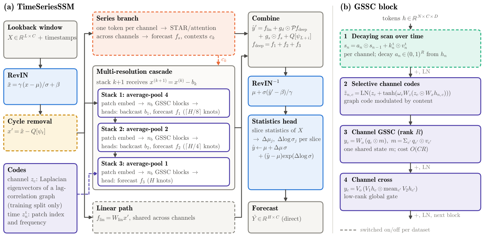
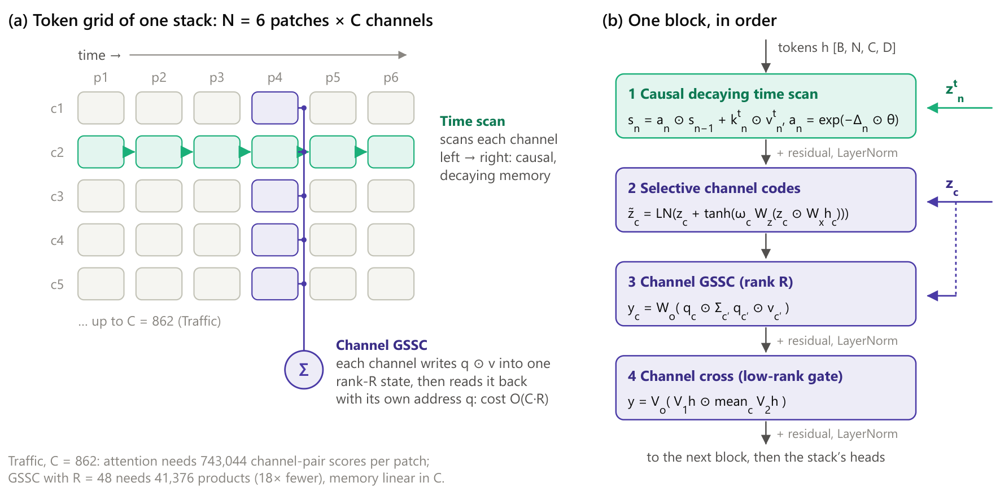
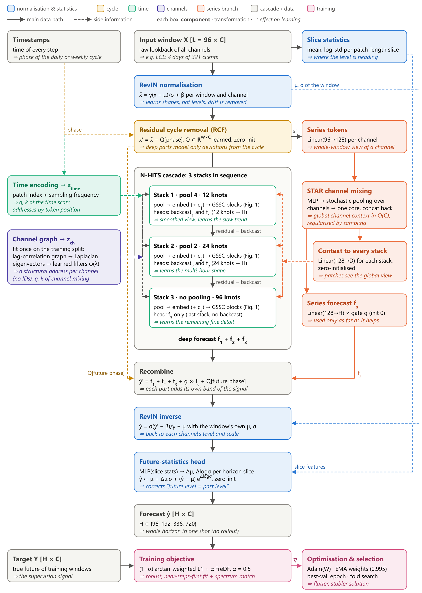
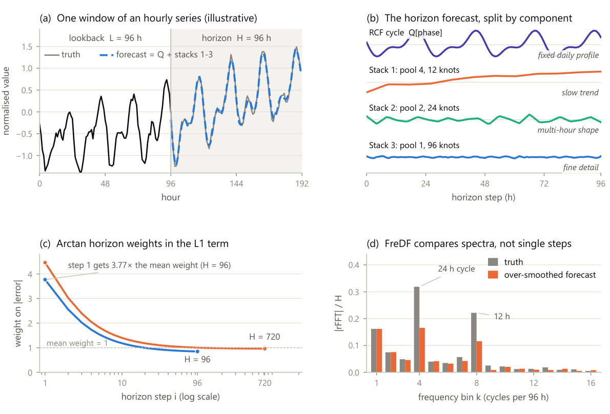

# TimeSeriesSSM

**Many Channels, One State: Graph State-Space Convolution for Multivariate Time Series Forecasting**
Steve Sojan, 2026 (preprint)

TimeSeriesSSM is a multivariate long-term forecaster that mixes channels with a modified form of
**graph state-space convolution (GSSC)** (Huang, Miao & Li, 2024). Each channel receives an *address* derived from a
correlation graph that is estimated on the training data and adjusted by the content of its series. It writes into a
single shared low-rank state and reads the state back through the same address. The cost is linear in the number of
channels for a fixed state rank, and no channel-by-channel matrix is ever formed.

On the seven datasets of the long-term track of the Time-Series-Library (TSLib) benchmark, TimeSeriesSSM has the
lowest MSE on five datasets and the lowest MAE on five, among the published results of nine models.

This repository contains the model, the training procedure of the paper, and the selected configuration of every
TSLib dataset.

## Architecture



**(a) Forecaster.** The lookback window $X\in\mathbb{R}^{L\times C}$ is processed in five stages:

1. **Normalisation and cycle removal.** The window is normalised per channel (RevIN), and a learned daily or weekly
   profile is subtracted (residual cycle forecasting).
2. **Multi-resolution cascade.** Three stacks with average-pooling kernels (4, 2, 1) read the same patch grid at
   decreasing coarseness, in the style of N-HiTS. Each stack explains the residual its predecessor leaves in the
   lookback, and forecasts $\lceil H/8\rceil$, $\lceil H/4\rceil$ and $H$ knots that are interpolated to the horizon.
3. **Optional paths.** A *series branch* embeds each channel's whole lookback as one token and mixes these tokens with
   STAR pooling and/or attention; an optional *linear path* maps the lookback directly to the horizon.
4. **Combination.** The forecasts are combined through per-step gates, and the cycle profile is added back.
5. **De-normalisation and correction.** RevIN is inverted, and a *statistics head* corrects the level and scale of
   every horizon slice.

**(b) GSSC block.** Each stack applies GSSC blocks to an $N\times C$ grid of patch tokens. A block has four steps:

1. **Decaying scan over time** (optional). A causal scan over the patches of each channel, with a content-dependent
   decay.
2. **Selective channel codes.** The channel codes come from the Laplacian eigenvectors of a lag-correlation graph,
   fitted once on the training split. The token content shifts them through a bounded residual update.
3. **Channel GSSC.** Each channel writes into one shared state through its address and reads it back through the same
   address: $m_n=\sum_{c'}q_{n,c'}\odot v_{n,c'}$, then $y_{n,c}=W_o(q_{n,c}\odot m_n)$. This costs $O(CR)$ for $C$
   channels and state rank $R$, and every state coordinate mixes the channels with a positive semi-definite kernel of
   rank at most one.
4. **Channel cross.** A low-rank gate of each channel by the channel average.



The model is trained on a horizon-weighted absolute error plus the FreDF frequency-domain error, keeps an exponential
moving average of its weights, and keeps the epoch with the lowest validation error.

<details>
<summary>Detailed data flow</summary>


</details>

<details>
<summary>Cascade and objective, illustrated on a synthetic series</summary>


</details>

## Results: TSLib long-term forecasting (lookback 96)

The numbers below are the test MSE / MAE on the normalised scale, averaged over the horizons {96, 192, 336, 720}.
TimeSeriesSSM is the mean of three seeds; the baselines are their published results. **Bold**: best per dataset and
metric. TimePro reports no Traffic results.

| Dataset | **TimeSeriesSSM** | TimeXer | TimeMixer | iTransformer | SOFTS | TimePro | PatchTST | TimesNet | RLinear | DLinear |
|---|---|---|---|---|---|---|---|---|---|---|
| ETTh1 | **0.429** / **0.429** | 0.437 / 0.437 | 0.447 / 0.440 | 0.454 / 0.447 | 0.449 / 0.442 | 0.438 / 0.438 | 0.469 / 0.454 | 0.458 / 0.450 | 0.446 / 0.434 | 0.456 / 0.452 |
| ETTh2 | 0.365 / **0.393** | 0.367 / 0.396 | **0.364** / 0.395 | 0.383 / 0.407 | 0.373 / 0.400 | 0.377 / 0.403 | 0.387 / 0.407 | 0.414 / 0.427 | 0.374 / 0.398 | 0.559 / 0.515 |
| ETTm1 | **0.380** / 0.396 | 0.382 / 0.397 | 0.381 / **0.395** | 0.407 / 0.410 | 0.393 / 0.403 | 0.391 / 0.400 | 0.387 / 0.400 | 0.400 / 0.406 | 0.414 / 0.407 | 0.403 / 0.407 |
| ETTm2 | **0.270** / **0.313** | 0.274 / 0.322 | 0.275 / 0.323 | 0.288 / 0.332 | 0.287 / 0.330 | 0.281 / 0.326 | 0.281 / 0.326 | 0.291 / 0.333 | 0.286 / 0.327 | 0.350 / 0.401 |
| Weather | **0.237** / **0.262** | 0.241 / 0.271 | 0.240 / 0.271 | 0.258 / 0.278 | 0.255 / 0.278 | 0.251 / 0.276 | 0.259 / 0.281 | 0.259 / 0.287 | 0.272 / 0.291 | 0.265 / 0.317 |
| ECL | **0.162** / **0.256** | 0.171 / 0.270 | 0.182 / 0.272 | 0.178 / 0.270 | 0.174 / 0.264 | 0.169 / 0.262 | 0.205 / 0.290 | 0.192 / 0.295 | 0.219 / 0.298 | 0.212 / 0.300 |
| Traffic | 0.461 / 0.280 | 0.466 / 0.287 | 0.484 / 0.297 | 0.428 / 0.282 | **0.409** / **0.267** | – | 0.481 / 0.304 | 0.620 / 0.336 | 0.626 / 0.378 | 0.625 / 0.383 |

TimeSeriesSSM per horizon (MSE / MAE, mean of seeds 2021–2023):

| Dataset | H = 96 | H = 192 | H = 336 | H = 720 |
|---|---|---|---|---|
| ETTh1 | 0.369 / 0.389 | 0.422 / 0.422 | 0.457 / 0.440 | 0.467 / 0.465 |
| ETTh2 | 0.286 / 0.334 | 0.361 / 0.385 | 0.407 / 0.421 | 0.408 / 0.434 |
| ETTm1 | 0.318 / 0.356 | 0.357 / 0.380 | 0.392 / 0.405 | 0.454 / 0.445 |
| ETTm2 | 0.168 / 0.245 | 0.232 / 0.288 | 0.293 / 0.329 | 0.390 / 0.388 |
| Weather | 0.148 / 0.190 | 0.200 / 0.239 | 0.261 / 0.284 | 0.339 / 0.337 |
| ECL | 0.131 / 0.224 | 0.148 / 0.240 | 0.178 / 0.273 | 0.192 / 0.287 |
| Traffic | 0.433 / 0.267 | 0.450 / 0.274 | 0.467 / 0.281 | 0.495 / 0.299 |

One configuration per dataset was selected on validation data, and the same configuration is used for all four
horizons. The paper gives the seed standard deviations, significance tests against the published values, and
controlled experiments that change one component at a time.

## Installation

TimeSeriesSSM needs Python 3.10 or later; its only dependencies are PyTorch, NumPy and pandas.

```bash
git clone https://github.com/stevesojan/timeseriesssm.git
cd timeseriesssm
pip install -e .            # or: pip install -r requirements.txt
python -m pytest tests      # 91 tests, CPU, about a minute
```

For GPU training, install a CUDA build of PyTorch first (https://pytorch.org). The results were produced with
Python 3.12, PyTorch 2.14 (CUDA 13.0), NumPy 2.5 and pandas 2.3, on one NVIDIA GeForce RTX 5050.

## Usage

### Forecasting your own series

`Forecaster` trains one model for one horizon with the training procedure of the paper. It takes NumPy arrays of
shape `[time, channels]` and their timestamps, and returns forecasts in the original units.

```python
import numpy as np
import pandas as pd
from timeseriesssm import Forecaster

values = np.load("my_series.npy")                                  # [T, C]
stamps = pd.date_range("2024-01-01", periods=len(values), freq="h")

train, val = slice(0, 7000), slice(7000 - 96, 8500)               # val includes the 96 steps before its first target

model = dict(
    patch_len=16, hidden_dim=128, rank_dim=64, num_blocks=2, dropout=0.1,
    cascade="nhits", nhits_blocks_per_stack=1, use_glu_ffn=False,
    time_mix="causal_decay",       # step 1: decaying scan over time ("off" to disable)
    channel_mix_scale=1.0,         # steps 2-4: graph state-space convolution across channels (0.0 to disable)
    rcf_cycle=24,                  # learned cycle of 24 steps (0 to disable)
    series_tokens=True, series_dim=128, series_layers=1, series_mixer="star",
    stat_head=True, mae_weight=1.0, mse_weight=0.0, horizon_weight="arctan", freq_loss_weight=0.5,
)
fc = Forecaster(model, {"lr": 1e-3, "epochs": 10, "batch_size": 32, "schedule": "cosine"},
                horizon=96, seq_len=96, freq="h")
fc.fit(values[train], values[val], stamps[train], stamps[val])

forecast = fc.predict(values[-96:], stamps[-96:])                  # [96, C], original units
metrics = fc.evaluate(values[8500 - 96:], stamps[8500 - 96:])     # {"mse", "mae", "windows"}, normalised scale
fc.save("model.pt")
fc = Forecaster.load("model.pt")
```

- `predict` also accepts a batch of windows, `[B, 96, C]` with timestamps `[B, 96]`. Timestamps can be any
  datetime-like values or seconds; they set the phase of the learned cycle.
- The channel graph is fitted on the training series only.
- `examples/quickstart.py` runs this workflow end to end on a synthetic series.

### The configurations of the paper

The selected configuration of each TSLib dataset ships as a preset (architecture and training settings):

```python
from timeseriesssm import Forecaster, list_presets
print(list_presets())   # ['ECL', 'ETTh1', 'ETTh2', 'ETTm1', 'ETTm2', 'Traffic', 'Weather']
fc = Forecaster.from_preset("Weather", horizon=336)
```

### Reproducing a TSLib result

Download the TSLib csv files (for example from the
[Time-Series-Library](https://github.com/thuml/Time-Series-Library) datasets), then run:

```bash
python examples/tslib_benchmark.py --data path/to/ETTh1.csv --horizon 96 --seed 2021
```

The script uses the official splits and training-split standardisation (`timeseriesssm.data.load_tslib`), trains the
preset, and prints the test MSE / MAE over every test window next to the value in the paper. For example, ETTh1 at
H = 96 with seed 2021 gives a test MSE of 0.370 against the paper's three-seed mean of 0.369.

GPU training uses non-deterministic CUDA kernels, so repeated runs with the same seed differ by up to about 1%.

### Using the model directly

`TimeSeriesSSM` is a regular `torch.nn.Module`. You can write your own training loop:

```python
import torch
from timeseriesssm import TimeSeriesSSM, TimeSeriesSSMConfig

cfg = TimeSeriesSSMConfig(patch_len=16, hidden_dim=64, rank_dim=32, cascade="nhits", nhits_blocks_per_stack=1,
                          use_glu_ffn=False, time_mix="causal_decay", context_len=96, horizon_len=24)
net = TimeSeriesSSM(cfg)
net.configure_channels(7)                   # channel-specific parameters (RevIN, channel codes)
net.fit_channel_graph(train_rows)           # [T, 7] normalised training rows: correlation graph and codes

x, y = torch.randn(32, 96, 7), torch.randn(32, 24, 7)
loss = net.loss(x, y, freq="h")             # training objective of the configuration
pred, _ = net.forward_window(x, 24, freq="h")   # [32, 24, 7]
```

With cycle removal (`rcf_cycle > 0`), pass `cycle_phase`, the position of every lookback and horizon step in the
cycle (`[B, L + H]`, long). `Forecaster` computes it from the timestamps.

`TimeSeriesSSMConfig` also exposes experimental options that the paper does not use, such as quantile heads and KAN
feed-forward layers. The presets contain the configurations of the paper.

## Repository layout

```
timeseriesssm/
├── forecaster.py        Forecaster (training, evaluation, prediction, save / load), TrainConfig, presets
├── data.py              TSLib loader (official splits and scaling)
├── presets/             selected configuration of each TSLib dataset
├── global_ssm.py        channel GSSC (shared-state mixer) and the original GSSC operator
├── selective_ssm.py     selective (content-dependent) channel codes
├── feature_graph.py     lag-correlation graph, normalised Laplacian, eigenpairs
├── positional_encoding.py   eigenvalue-augmented codes
└── model/
    ├── timeseries_ssm.py    TimeSeriesSSM, TimeSeriesSSMConfig, statistics head, objective
    ├── timeseries_block.py  the GSSC block
    ├── nhits_cascade.py     multi-resolution cascade
    ├── causal_ssm.py        decaying scan over time
    ├── channel_graph.py     channel codes from the graph
    ├── series_tokens.py     series branch (STAR / attention)
    └── revin.py, heads.py, patch_embed.py, time_encoding.py, ...
examples/                quickstart.py, tslib_benchmark.py
tests/                   unit tests (model, API, presets)
figures/                 figures of the paper
```

## Citation

```bibtex
@article{sojan2026timeseriesssm,
  title   = {Many Channels, One State: Graph State-Space Convolution for Multivariate Time Series Forecasting},
  author  = {Sojan, Steve},
  year    = {2026},
  note    = {Preprint}
}
```

TimeSeriesSSM builds on graph state-space convolution: Huang, Miao and Li, *What Can We Learn from State Space Models
for Machine Learning on Graphs?* (2024). Baseline numbers are taken from the publications of the respective models.

## License

Apache License 2.0; see [LICENSE](LICENSE).
